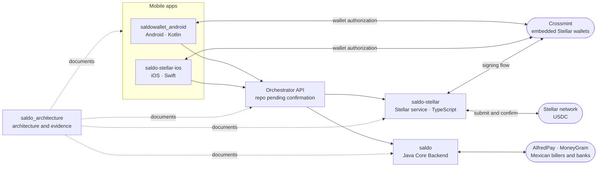

# Saldo Repository Map

Saldo is integrating Stellar USDC into its native Android and iOS applications and Mexican bill-payment infrastructure. This repository is the entry point: it maps every Saldo repository to the part of the system it implements.

The canonical inventory lives in [saldo_architecture › docs/repositories.md](https://github.com/unfodl/saldo_architecture/blob/main/docs/repositories.md). The architecture itself is described in [saldo_architecture](https://github.com/unfodl/saldo_architecture).

## Repositories

| Repository | Visibility | Role | Stack |
| --- | --- | --- | --- |
| [unfodl/saldo_architecture](https://github.com/unfodl/saldo_architecture) | Public | Architecture, security, reconciliation, roadmap, and acceptance evidence for SCF #46 | Markdown, Mermaid |
| [unfodl/saldo_web](https://github.com/unfodl/saldo_web) | Public | This repository map. The historical web prototype is archived (see below) | — |
| [unfodl/saldo](https://github.com/unfodl/saldo) | Private | Java Core Backend: billers, banks, partners (AlfredPay, MoneyGram), and compliance | Java |
| [unfodl/saldowallet_android](https://github.com/unfodl/saldowallet_android) | Private | Native Android wallet app: Crossmint embedded Stellar wallet, USDC balance, send/receive, bill pay, top-ups, recovery | Kotlin, Compose Multiplatform |
| [unfodl/saldo-stellar](https://github.com/unfodl/saldo-stellar) | Private | Stellar settlement service: transaction construction, submission, confirmation, indexing, onchain monitoring | TypeScript |
| [unfodl/saldo-stellar-ios](https://github.com/unfodl/saldo-stellar-ios) | Private | Native iOS wallet app | Swift |
| Orchestrator API | — | Workflow, payment state, idempotency, cross-system references | TypeScript — repository pending technical confirmation |

Private repositories can be shared with reviewers on request without making code or secrets public.

## How the repositories fit together

Rounded nodes are external services; square nodes are Saldo repositories.

## Where to start

| If you want to… | Go to |
| --- | --- |
| Understand the overall design | [Technical architecture](https://github.com/unfodl/saldo_architecture/blob/main/docs/architecture.md) |
| See who owns what | [Repository and responsibility inventory](https://github.com/unfodl/saldo_architecture/blob/main/docs/repositories.md) |
| Review wallet custody, signing, and recovery | [Wallet security](https://github.com/unfodl/saldo_architecture/blob/main/docs/wallet-security.md) |
| Check how delivery is verified | [Acceptance tests and mainnet metrics](https://github.com/unfodl/saldo_architecture/blob/main/docs/acceptance-tests.md) |
| See how payments are monitored | [Onchain and operational monitoring](https://github.com/unfodl/saldo_architecture/blob/main/docs/onchain-monitoring.md) |

## Archived web prototype

This repository previously held a Next.js store-operator payments prototype (Crossmint/Stellar). It is historical work, excluded from SCF #46 funded scope and metrics, and is preserved unchanged:

- Tag [`web-prototype-2026-08`](https://github.com/unfodl/saldo_web/tree/web-prototype-2026-08) and branch [`web-prototype`](https://github.com/unfodl/saldo_web/tree/web-prototype): last state of `main`
- Branches [`master`](https://github.com/unfodl/saldo_web/tree/master) and [`development`](https://github.com/unfodl/saldo_web/tree/development): later prototype work, also tagged `web-prototype-master-2026-08` and `web-prototype-development-2026-09`
